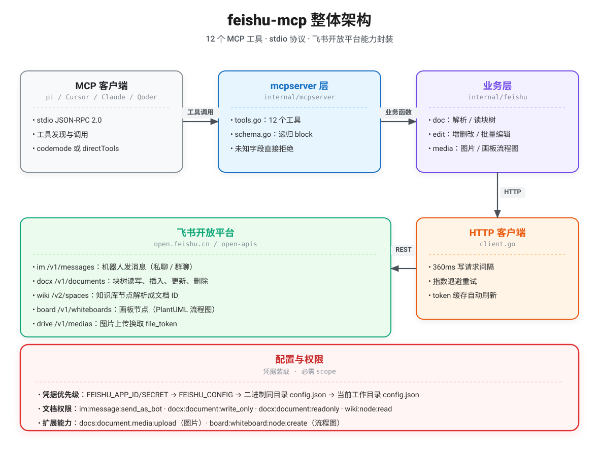
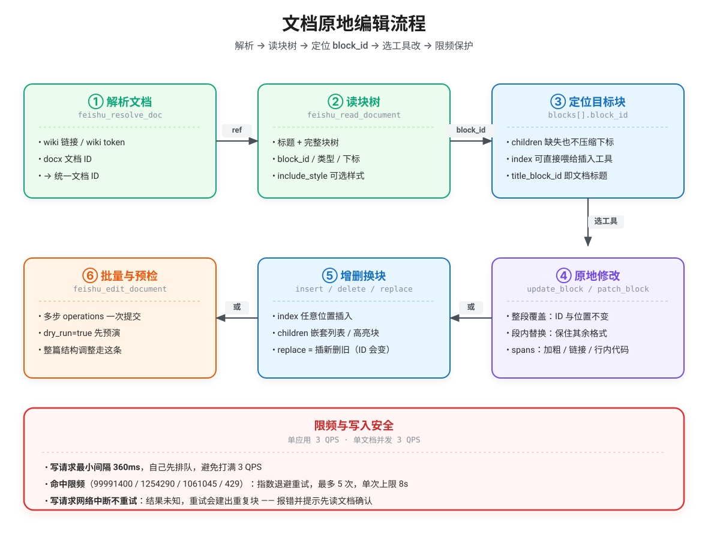
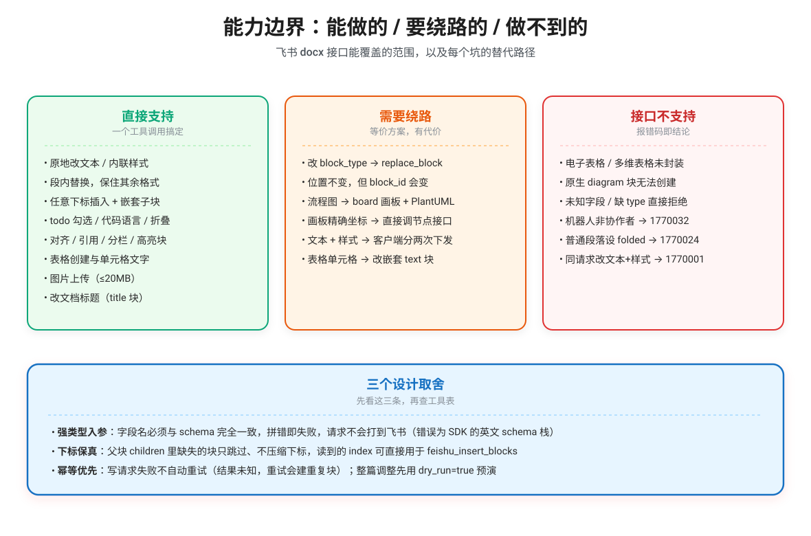

# feishu-mcp

飞书机器人的 stdio MCP 服务（Go 版），基于官方 [MCP Go SDK](https://github.com/modelcontextprotocol/go-sdk)：把飞书开放平台能力封装成 **12 个 MCP 工具**，供 pi、Cursor、Claude Desktop、Qoder 等任意 MCP 客户端调用。

**重点：支持原地编辑已有段落** —— `feishu_update_block` 改一段话，文字变了、`block_id` 和文档位置都不变，前后结构不受影响。不是只能"文末追加 / 整段删除"。

单个静态二进制 · 无运行时依赖 · 日志只走 stderr（stdout 专供 MCP 协议）

<p align="center">
  
</p>
<p align="center">
  <sub>图源 <a href="docs/architecture.excalidraw">docs/architecture.excalidraw</a>，可在 <a href="https://excalidraw.com">Excalidraw</a> 导入编辑</sub>
</p>

## 快速开始

```bash
cp config.example.json config.json    # 填 app_id / app_secret，或用 FEISHU_APP_ID / FEISHU_APP_SECRET
go build -trimpath -ldflags="-s -w" -o feishu-mcp .
./feishu-mcp                          # 从 stdin/stdout 跑 MCP stdio 服务
```

推荐装到 `~/.pi/mcp-servers/feishu-mcp/`（二进制 + 同级 `config.json`），这样不依赖启动时的工作目录：

```bash
mkdir -p ~/.pi/mcp-servers/feishu-mcp && \
go build -trimpath -ldflags="-s -w" -o ~/.pi/mcp-servers/feishu-mcp/feishu-mcp . && \
cp config.json ~/.pi/mcp-servers/feishu-mcp/
```

静态门禁：`go build ./... && go vet ./... && go test ./...`

## 12 个工具

| 工具 | 说明 |
| --- | --- |
| `feishu_send_message` | 以机器人身份发消息（私聊 / 群聊，默认纯文本） |
| `feishu_resolve_doc` | wiki 链接 / wiki token / docx 文档 ID → 文档 ID |
| `feishu_read_document` | 读标题 + 完整块树（`block_id`、类型、下标、层级、可选样式） |
| `feishu_update_block` | **原地改块**的内容 / 内联样式 / 块级样式，位置与 ID 不变 |
| `feishu_patch_block` | 段内查找替换，保留该段其余文字的内联样式 |
| `feishu_insert_blocks` | 任意下标插入，支持 `children` 嵌套（列表缩进、高亮块等） |
| `feishu_append_document` | 末尾追加（等价 `insert_blocks(index=-1)`，保留兼容） |
| `feishu_delete_block` | 按 `block_id` 删除（任意层级，含子块） |
| `feishu_replace_block` | 换块类型：同位置插新块 + 删旧块（`block_id` 会变） |
| `feishu_edit_document` | 一次提交多步编辑，支持 `dry_run` 预检 |
| `feishu_insert_image` | 上传图片并插入（本地路径或 http(s) URL，返回可复用 `file_token`） |
| `feishu_insert_flowchart` | 插画板块并用 PlantUML 渲染流程图 |

## 怎么改文档

<p align="center">
  
</p>

```text
feishu_read_document(ref)                                # 拿 blocks[].block_id 与下标
feishu_update_block(ref, block_id, text="新内容")          # 整段覆盖，ID 与位置不变
feishu_patch_block(ref, block_id, find="旧词", replace="新词")   # 只换几个字，保住加粗/链接
feishu_insert_blocks(ref, blocks, index=3)                # 插到第 3 个块之前
feishu_insert_blocks(ref, blocks, parent_block_id=<列表项>)  # 给列表项加子项
feishu_edit_document(ref, operations, dry_run=true)       # 整篇调整先预演，再真跑
```

### 块定义格式

`feishu_insert_blocks` / `feishu_replace_block` / `feishu_append_document` / `feishu_edit_document` 共用：

```json
{"type": "heading2", "text": "背景"}
{"type": "text", "spans": [{"text": "加粗", "bold": true}, {"text": "普通"}]}
{"type": "bullet", "text": "父项", "children": [{"type": "bullet", "text": "子项"}]}
{"type": "todo", "text": "待办", "done": false}
{"type": "code", "text": "print(1)", "language": "python"}
{"type": "divider"}
{"type": "table", "rows": [["表头A", "表头B"], ["值1", {"type": "todo", "text": "待办", "done": true}]], "header_row": true}
{"type": "callout", "text": "高亮内容", "background_color": "lightyellow"}
```

- `type` 必填，支持 `text` / `heading1`~`heading9` / `bullet` / `ordered` / `quote` / `todo` / `code` / `divider` / `table` / `callout` / `table_cell`；也接受 `h1`~`h9`、`title`、`subtitle`、`paragraph`、`ul`、`ol`、`checkbox`、`hr`、`pre` 等别名。
- `spans` 用于同段内混合样式（`bold` / `italic` / `underline` / `strikethrough` / `inline_code` / `link`），给了就忽略 `text`。
- `block_style` 改块级样式：`align`、`done`、`folded`、`language`、`wrap`、`indentation_level`、`background_color`、`sequence`。
- 高亮块、分栏列必须至少有一个子块；`callout` 传 `text` 时自动补文本子块。

## 能力边界

<p align="center">
  
</p>

图片与流程图：

```text
feishu_insert_image(ref, source="/abs/path/shot.png", align="center")
feishu_insert_image(ref, source="https://example.com/a.png")
feishu_insert_flowchart(ref, plantuml="@startuml\nstart\n:读取文档;\nstop\n@enduml")
```

只建空白画板时用 `{"type":"board"}` / `{"type":"image","token":"..."}` 走 `feishu_insert_blocks`，再用画板节点接口自行摆放精确坐标。飞书 docx 的 `diagram` 块**无法通过 API 创建**（`1770029`），所以流程图走「`board` 画板块 + `/board/v1/whiteboards/{id}/nodes/plantuml`」。

### 需要的权限（scope）

`im:message:send_as_bot` · `docx:document:write_only` · `docx:document:readonly` · `wiki:node:read` · `docs:document.media:upload`（图片）· `board:whiteboard:node:create`（流程图）

要操作的文档必须把机器人加为**可编辑**协作者，否则写入报 `1770032 forBidden`。

## 接入 MCP 客户端

**pi**（用户级共享配置 `~/.config/mcp/mcp.json`，与 `gopls-lsp` 同一份）：

```json
{
  "mcpServers": {
    "feishu": {
      "command": "/Users/你/.pi/mcp-servers/feishu-mcp/feishu-mcp",
      "lifecycle": "lazy",
      "requestTimeoutMs": 60000,
      "description": "飞书机器人：发消息、读文档块树、原地编辑段落"
    }
  }
}
```

改完 `/reload`；校验 `~/.pi/agent/npm/node_modules/.bin/pi-mcp-adapter doctor`（期望 `feishu → state ok`）。工具名形如 `mcp__feishu__feishu_read_document`，默认走 codemode（模型用 `searchTools()` 发现），想让模型直接看到全部工具就给 entry 加 `"directTools": true`。

注意 `pi mcp list` 读的是 pi 自带的 `~/.pi/agent/mcp.json`，与上面这份共享配置是两套，不要重复注册。用 pi 自带位置则：

```bash
pi mcp add feishu --env FEISHU_APP_ID=cli_xxx --env FEISHU_APP_SECRET=xxx \
  --exposure deferred -- /Users/你/.pi/mcp-servers/feishu-mcp/feishu-mcp
```

**通用 JSON**（Qoder `~/.qoder/settings.json` / Cursor `~/.cursor/mcp.json` 等）：

```json
{
  "mcpServers": {
    "feishu": {
      "command": "/绝对路径/feishu-mcp",
      "env": { "FEISHU_APP_ID": "cli_xxx", "FEISHU_APP_SECRET": "xxx" }
    }
  }
}
```

`env` 不放凭据时回退到 `config.json`，优先级：`FEISHU_APP_ID/SECRET` → `FEISHU_CONFIG` 指向的文件 → 二进制同目录 `config.json` → 当前工作目录 `config.json`。

## 目录结构

```
feishu-mcp/
├── main.go                  # 凭据装载 + stdio MCP 服务入口
├── internal/
│   ├── feishu/              # client(限频/重试/token) · config · errors · types
│   │   ├── doc.go           #   resolve / read / 树构建 / locate
│   │   ├── edit.go          #   insert / update / patch / delete / replace
│   │   ├── editdocument.go  #   批量编辑
│   │   ├── blocks.go / elements.go / types.go   # 块定义规整、富文本、枚举
│   │   └── message.go / media.go                # 发消息、图片、画板流程图
│   └── mcpserver/           # server · tools(12 个入参) · schema(递归 $defs)
├── docs/                    # 架构图源文件（.excalidraw + .svg + .png）
└── config.example.json      # 凭据模板（真实 config.json 已 gitignore）
```

## 已知行为

| 行为 | 说明 |
| --- | --- |
| `dry_run` 也校验必填参数 | `find` / `start_index` / `end_index` 在 `dry_run` 下同样必填 |
| 空文档的 `blocks` 是 `[]` | 不是 `null`，可直接遍历；`revision_id` 拿不到时为 `0` |
| `include_style=true` 时空样式省略 | 该块没有块级样式时不下发 `style` 键 |
| `replace_block` 传空 `blocks` | 等价删除，回包里带 `deleted` |
| `update_block` 分两次下发 | 飞书 `batch_update` 不允许同请求既改文本又改样式（`1770001`）；第二次失败会提示"文本已改完、样式未生效" |
| `feishu_read_document` 无 outputSchema | 返回递归树，靠 `structuredContent` + `content[0].text` 携带 |
